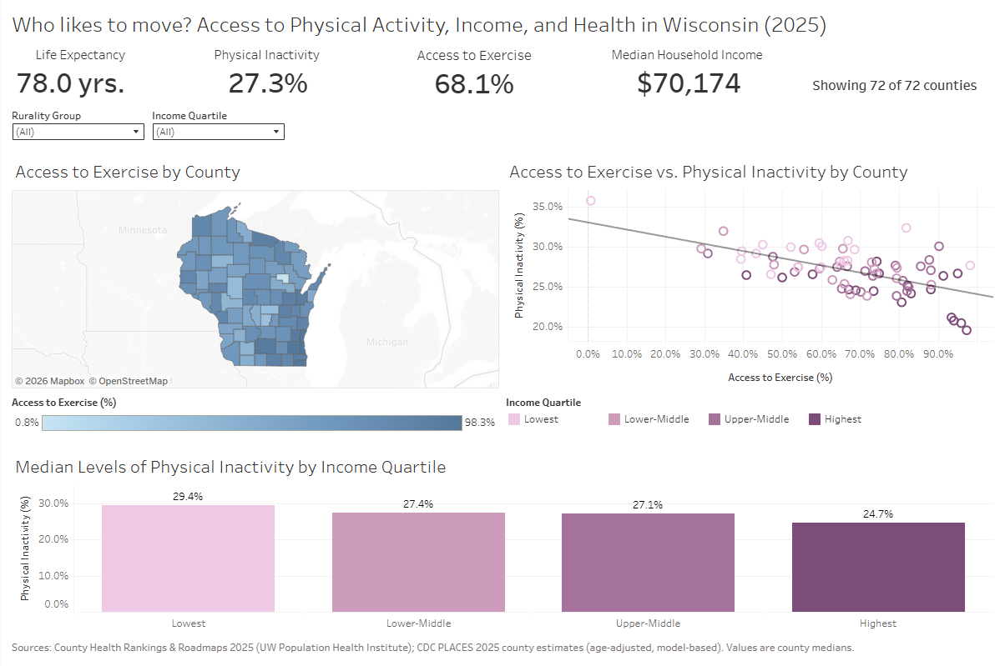

# Wisconsin County Health Dashboard

An interactive Tableau dashboard that compares physical activity, access to exercise opportunities, and health outcomes across all 72 Wisconsin counties by rurality and income. It's built on County Health Rankings and CDC PLACES data that I validated and joined in SQL.

**[View the live dashboard on Tableau Public](https://public.tableau.com/views/wi_county_analysis/Dashboard1)**



## Question

How do physical inactivity, access to exercise opportunities, and life expectancy differ between rural and urban counties, and between lower- and higher-income counties in Wisconsin?

## Data

| Source | What it provides | Release used |
| --- | --- | --- |
| [County Health Rankings & Roadmaps](https://www.countyhealthrankings.org/health-data/methodology-and-sources/data-documentation) | County-level health outcomes, health factors, and social and economic measures | 2025 |
| [CDC PLACES](https://data.cdc.gov/500-Cities-Places/PLACES-County-Data-GIS-Friendly-Format-2025-releas/i46a-9kgh/about_data) | Model-based county estimates of chronic disease, health behaviors, and social needs | 2025 |

Both sources are public. The raw files are not stored here; use the links above to download them. The final analysis table used in the dashboard is in `data/`, one row per county, sorted by FIPS code.

## Approach

1. **Prepare and load:** Restructured the County Health Rankings file, which had two header rows and nearly 800 columns, and loaded both sources into Google BigQuery.
2. **Check each source** (`01`, `02`): Confirmed 72 counties plus one statewide row in County Health Rankings, unique and valid county FIPS codes, prevalence values between 0 and 100, and no missing values in the PLACES measures used.
3. **Check the join** (`03`): Ran anti-joins in both directions to confirm that all 72 counties match, and cross-checked county population between sources (identical for every county).
4. **Build the analysis table** (`04`): Converted FIPS codes stored as integers to text for a consistent join key, put all percentages on one 0–100 scale, and joined about 40 measures. Used window functions to derive income quartiles, life expectancy rankings, and differences from statewide values.
5. **Validate** (`05`): Checked row counts and missing values in the final table and spot-checked Dane County against the source data.
6. **Analyze** (`06`): Calculated Pearson correlations and group medians in SQL, and tested whether results held without the most extreme outlier.
7. **Visualize:** Built a Tableau dashboard with KPI cards and cross-filters for rurality and income quartile.

**Definitions:** Rurality groups use the County Health Rankings percent-rural measure: *completely rural* (100% rural), *mostly rural* (50% to under 100%), and *mostly urban* (under 50%). Income quartiles divide the 72 counties into four groups of 18 by median household income.

## Key Findings

- Counties with greater access to exercise opportunities had lower physical inactivity (r = −0.61), and the association with median household income was stronger (r = −0.73).
- Median physical inactivity was **29.4%** in the lowest-income quartile of counties and **24.7%** in the highest. Median life expectancy was **76.2** and **79.4** years, respectively.
- In the median completely rural county, **64%** of residents had adequate access to locations for physical activity, compared with **86%** in mostly urban counties.
- Both associations held when Menominee County, the most extreme outlier, was excluded (r = −0.53 and −0.72).

## Limitations

- **County-level data:** These are comparisons between counties, so they don't describe individuals (the ecological fallacy).
- **Modeled estimates:** CDC PLACES values are model-based small-area estimates, partly informed by county poverty data, which may strengthen their association with income.
- **Cross-sectional:** The data show associations at one point in time, not causes.

## Repository Contents

```
wi-county-health/
├── README.md
├── sql/
│   ├── 01_chr_load_checks.sql
│   ├── 02_places_load_checks.sql
│   ├── 03_join_checks.sql
│   ├── 04_build_analysis_table.sql
│   ├── 05_validate_analysis_table.sql
│   └── 06_findings.sql
├── data/
│   └── wi_county_analysis.csv
└── images/
    └── dashboard.png
```

Run the SQL files in numbered order. Each check query lists its expected result in a comment.

## Tools

Google BigQuery (SQL) · Tableau Public

## Author

**Nathan Tokarek** · [Portfolio](https://nathantokarek.wordpress.com) · [LinkedIn](https://www.linkedin.com/in/natetoke/) · [Tableau Public](https://public.tableau.com/app/profile/nathan.tokarek)
